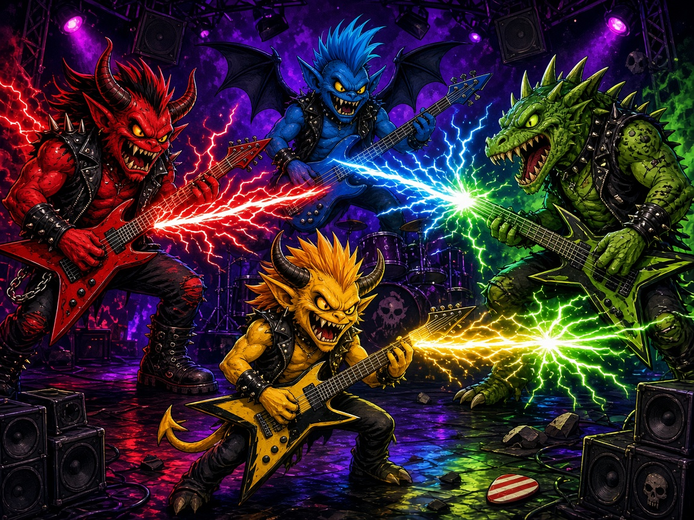

# Riff Royale

Four note highways. One screen. Last riff standing.

Riff Royale is a 4-player local rhythm duel. Each player owns a quadrant with three lanes. Notes fall in time with a song synthesized in the browser. Hit them in the Perfect or Good window to score and fill a lightning meter. Spend that meter to scramble a rival's highway and knock their HP down. Misses hurt. The last player standing wins the round — or, if the song ends first, the highest HP does. Win the most rounds to take the match.

Everything runs offline: one HTML page, vanilla JavaScript, and the Web Audio API. No build step and no external assets beyond the cover and icon in this repo.

## Launch

The game is an ES module page, so it needs the tiny local server in `server.py` (Python 3 standard library only). It binds `127.0.0.1` on port **8810**, or the next free port if 8810 is taken, and opens your browser.

| Platform | How |
| --- | --- |
| macOS | Double-click `launch-mac.command` |
| Windows | Double-click `launch-windows.bat` |
| Linux | `chmod +x launch-linux.sh` once, then `./launch-linux.sh` |
| From a terminal | `python3 server.py` |

If Python 3 is missing, the launcher tells you instead of failing silently.

Mute with **M** at any time. Volume, round count (1, 3, or 5), and key bindings are on the settings screen and are saved in `localStorage`.

## Controls

Keyboard works with no gamepads. On the join screen, your action key sits you down as a human and your secondary key cycles that seat through human, bot, and off. Empty seats can be bots, so one person can play against the machine.

| Player | Move | Hit | Zap |
| --- | --- | --- | --- |
| P1 | W A S D | F | G |
| P2 | Arrow keys | / | . |
| P3 | I J K L | ; | ' |
| P4 | Numpad 8 4 5 6 | Numpad 0 | Numpad Enter |

Up and down choose which rival the lightning will hit. Left and right change lanes. P4's numpad cluster uses 8 up, 4 left, 5 down, 6 right.

**Gamepad.** Pads 0–3 map to P1–P4 through the browser Gamepad API. Left stick or D-pad moves, **A** hits, **B** zaps, **Start** pauses. A connected pad overrides that player's keyboard until it is unplugged, including hot-plug mid-match. The HUD shows a pad icon while it is connected. Enter, Esc, and M stay global and are not remapped. Open settings from the title screen with P1's zap key (G by default).

**Pause** with Esc or Start: resume, settings, or quit to the title.

## Rules

- Four highways, one per quadrant, three lanes each. The chart is generated from a seed and the song's BPM, so the same seed rebuilds the same duel.
- **Perfect** is within 50 ms of the note. **Good** is within 110 ms. Anything later is a miss. Early presses outside the window do not eat the note.
- A **spark** note is a pickup: it scores like a normal hit and also heals a little HP and adds extra charge.
- Streaks fill the lightning meter. At full charge, zap fires a bolt at the rival you have targeted. The hit costs them HP and, for a short time, scrambles their lanes and speeds their highway up.
- Each player starts at 100 HP. Misses and lightning drain it. At 0 HP that player is eliminated.
- A round ends when only one player is left, or when the song ends. The survivor wins; otherwise the highest HP wins, then score.
- A match is a configured number of rounds. Most round wins takes it. Points, then seat order, break ties.
- Bots fill any seat that isn't a human and isn't switched off, using the same seeded RNG as the chart.

## Scoring

| Result | Score | HP | Charge |
| --- | --- | --- | --- |
| Perfect | +100 | — | +14 |
| Good | +50 | — | +8 |
| Spark (added to the hit) | +25 | +6 | +10 |
| Miss | 0 | −8 | leaks 12 |
| Lightning hit | — | −18 to the rival | attacker meter resets |

The HUD shows HP, score, streak, charge, and the current target. Round wins and total points are on the match-end standings.

## arcade.json

`arcade.json` is the arcade-OS manifest at the repo root. It names the game (`riffroyale`), points at `assets/icon.jpg` and `assets/cover.jpg`, lists the one-click launchers plus `index.html`, and declares 4 players (minimum 1), keyboard and gamepad input, version `1.0.0`, and port `8810`. `server.py` reads that port when it starts.

## Tests

Core rules live in `src/core/` with no DOM and no canvas, so they run headlessly. Rendering, input devices, and audio live in `src/ui/`.

```bash
node --test tests/
python3 tests/smoke_server.py
```

`node --test` covers lane movement and note/receptor collision, Perfect/Good/Miss scoring, spark pickups, lightning, elimination, round and match winners, seeded RNG and chart determinism, keyboard and mocked gamepad mapping, settings sanitizing, and that `arcade.json` points at files that exist. The Python smoke test launches `server.py` with `--no-browser` and checks that it serves `index.html`. GitHub Actions runs both on push and pull request.

## License

MIT. See [LICENSE](LICENSE).
